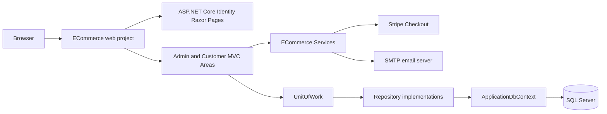

# ECommerce Learning Project

A learning-oriented e-commerce web application built with **ASP.NET Core on .NET 10**. The project demonstrates how a multi-project web solution can combine MVC controllers, Razor Pages, Entity Framework Core, ASP.NET Core Identity, repository/unit-of-work abstractions, and a Stripe Checkout integration.

## What this project demonstrates

- Building an ASP.NET Core web application with **MVC Areas** and **Razor Pages**
- Organizing an application into models, data access, services, utilities, and web layers
- Using **Entity Framework Core** with SQL Server and migrations
- Implementing registration, login, email confirmation, password recovery, lockout, and Identity account-management pages
- Applying role-based authorization for administrative features
- Modeling products, categories, carts, orders, order items, reviews, wishlists, and audit logs
- Using the Repository and Unit of Work patterns
- Creating Stripe Checkout sessions and confirming successful payments
- Sending email notifications through SMTP
- Building a responsive interface with Bootstrap, jQuery, and custom CSS

## Main features

### Customer area

- Browse products and filter by category
- View product details, stock availability, and reviews
- Add products to a cart and increase, decrease, or remove quantities
- Validate cart quantities against available stock
- Submit delivery information during checkout
- Complete payment through Stripe Checkout
- View order history and order details
- Cancel pending orders
- Add, remove, and move wishlist products to the cart
- Add product reviews for authenticated users

### Administration area

The Admin area is protected with `[Authorize(Roles = "Admin")]` and includes:

- Dashboard statistics for products, orders, customers, revenue, low-stock products, and best-selling products
- Product CRUD operations with image upload and replacement
- Category CRUD operations
- Order listing, details, and status updates
- User management and role assignment
- Role CRUD operations
- Audit entries for selected administrative actions
- Email notifications when order status changes

### Identity and accounts

The application uses ASP.NET Core Identity with a custom `ApplicationUser` containing `FullName` and `Address` fields. The included Identity UI covers:

- Registration and login
- Required email confirmation before sign-in
- Password reset and password management
- Account lockout pages
- Two-factor authentication pages
- Recovery codes
- External-login UI scaffolding
- Personal-data management pages

## Technology stack

| Area | Technology |
| --- | --- |
| Runtime | .NET 10 (`net10.0`) |
| Web framework | ASP.NET Core MVC and Razor Pages |
| Authentication | ASP.NET Core Identity |
| ORM | Entity Framework Core 10 |
| Database | SQL Server |
| Payments | Stripe Checkout via `Stripe.net` |
| Frontend | Razor views, HTML, CSS, Bootstrap, jQuery |
| IDE used during development | Visual Studio Community 2026 |

## Solution structure

```text
ECommerce.slnx
├── ECommerce/                  # Web application
│   ├── Areas/
│   │   ├── Admin/              # Admin MVC area and views
│   │   ├── Customer/           # Customer MVC area and views
│   │   └── Identity/           # ASP.NET Core Identity Razor Pages
│   ├── Views/                  # Shared MVC views and layout
│   ├── wwwroot/                # CSS, JavaScript, libraries, product images
│   └── Program.cs              # Dependency injection and HTTP pipeline
├── ECommerce.Models/           # Entities, enums, and view models
├── ECommerce.DataAccess/       # DbContext, migrations, repositories, UnitOfWork
├── ECommerce.Services/         # User, role, and payment services
└── ECommerce.Utility/          # SMTP email sender
```

### Request and data flow



## Domain model

The main entities are:

- `ApplicationUser` - Identity user with name and address information
- `Product` - product details, price, image path, stock, and category
- `Category` - product grouping and display order
- `Cart` and `CartItem` - authenticated-user shopping carts
- `Order` and `OrderItem` - checkout records and purchased products
- `Review` - product rating and comment submitted by a user
- `Wishlist` - saved products for an authenticated user
- `AuditLog` - selected administrative actions and affected entities

Orders support statuses such as `Pending`, `Processing`, `Shipped`, `Completed`, and `Cancelled`. The model also includes `CashOnDelivery` and `Card` payment-method values, while the current checkout flow creates a Stripe Checkout session.

## Prerequisites

Install the following before running the project:

- [.NET 10 SDK](https://dotnet.microsoft.com/download/dotnet/10.0)
- SQL Server or SQL Server Express/LocalDB
- A Stripe account and test API key if you want to test online payment
- An SMTP account if you want to test email confirmation and notifications
- The EF Core CLI tool, if it is not already installed:

```powershell
dotnet tool install --global dotnet-ef
```

## Configuration

The application intentionally does not store the database connection string, Stripe secret key, or SMTP credentials in the repository. Configure them with .NET user secrets from the repository root:

```powershell
dotnet user-secrets init --project .\ECommerce\ECommerceWeb.csproj

dotnet user-secrets set "ConnectionStrings:DefaultConnection" "Server=(localdb)\\MSSQLLocalDB;Database=ECommerceDb;Trusted_Connection=True;TrustServerCertificate=True" --project .\ECommerce\ECommerceWeb.csproj

dotnet user-secrets set "Stripe:SecretKey" "sk_test_your_key_here" --project .\ECommerce\ECommerceWeb.csproj

dotnet user-secrets set "EmailSettings:Username" "your-smtp-account@example.com" --project .\ECommerce\ECommerceWeb.csproj
dotnet user-secrets set "EmailSettings:Password" "your-smtp-password-or-app-password" --project .\ECommerce\ECommerceWeb.csproj
```

`appsettings.json` already contains the SMTP server and port defaults for Gmail and the local application base URL. Change these values in local configuration when needed:

```json
{
  "EmailSettings": {
	"SmtpServer": "smtp.gmail.com",
	"Port": "587"
  },
  "AppSettings": {
	"BaseUrl": "http://localhost:8080"
  }
}
```

Use test credentials only during development. Never commit API keys, SMTP passwords, connection-string passwords, or user-secrets files.

## Database setup

The solution includes an initial Entity Framework Core migration in `ECommerce.DataAccess/Migrations`.

From the repository root, restore dependencies and apply the migration:

```powershell
dotnet restore
dotnet ef database update --project .\ECommerce.DataAccess\ECommerce.DataAccess.csproj --startup-project .\ECommerce\ECommerceWeb.csproj
```

The model configuration seeds:

- `Admin`, `Customer`, and `Employee` roles
- An administrator Identity user
- Example categories such as Electronics, Computers, Accessories, Gaming, and Mobile
- Example products

The seeded administrator email is defined in `ECommerce.DataAccess/Data/ApplicationDbContext.cs`. The password is intentionally not documented here; use a safe local development credential-management approach if you need to administer the seeded account.

## Run the application

Run the web project from the repository root:

```powershell
dotnet run --project .\ECommerce\ECommerceWeb.csproj
```

The launch profiles use these local URLs:

- HTTP: `http://localhost:5295`
- HTTPS: `https://localhost:7097`

The default route opens the Customer home page:

```text
/{area=Customer}/{controller=Home}/{action=Index}/{id?}
```

The application uses HTTPS redirection outside development and serves static files from `ECommerce/wwwroot`.

## Typical user flows

### Customer purchase flow

```text
Register
  → Confirm email
  → Sign in
  → Browse/filter products
  → View details
  → Add to cart
  → Enter delivery information
  → Pay with Stripe Checkout
  → Confirm payment
  → Stock is reduced and cart is cleared
  → Review order history
```

### Admin flow

```text
Sign in with the Admin role
  → Open the Admin area
  → Manage categories and products
  → Review orders
  → Update order status
  → Manage users and roles
  → Review dashboard metrics
```

## Design patterns and practices shown

- **Layered solution structure** separates web, models, data access, services, and utilities.
- **Dependency injection** registers `IUnitOfWork`, `IUserService`, `IRoleService`, `IPaymentService`, and `IEmailSender` in `Program.cs`.
- **Repository pattern** provides entity-specific repository interfaces and implementations.
- **Unit of Work** groups repository access and persists changes through one `Save()` operation.
- **View models** shape data for forms and pages without requiring views to bind directly to every domain entity.
- **Areas** separate Admin, Customer, and Identity functionality.
- **Data annotations and model validation** are used on entities and checkout/account input models.

## Learning goals

This project is useful for practicing:

- ASP.NET Core application startup and dependency injection
- MVC Areas and Razor Pages routing
- Identity authentication and role-based authorization
- EF Core entity relationships, seed data, and migrations
- CRUD workflows and form validation
- Service and repository abstractions
- Checkout and payment-provider integration concepts
- Email confirmation and notification workflows
- Responsive UI development with Bootstrap

## Known learning-project limitations

This repository is intentionally suitable for learning rather than production deployment. Before treating it as a production system, consider adding or reviewing:

- Automated unit, integration, and end-to-end tests
- Stronger validation and centralized exception handling
- Production-grade payment webhooks and idempotency handling
- Transaction boundaries around checkout, stock updates, and payment confirmation
- Secure file-upload validation and storage
- More complete audit coverage
- Async data-access methods throughout the service and repository layers
- Observability, structured logging, rate limiting, and deployment configuration
- Production secret management and a carefully managed administrator provisioning process
